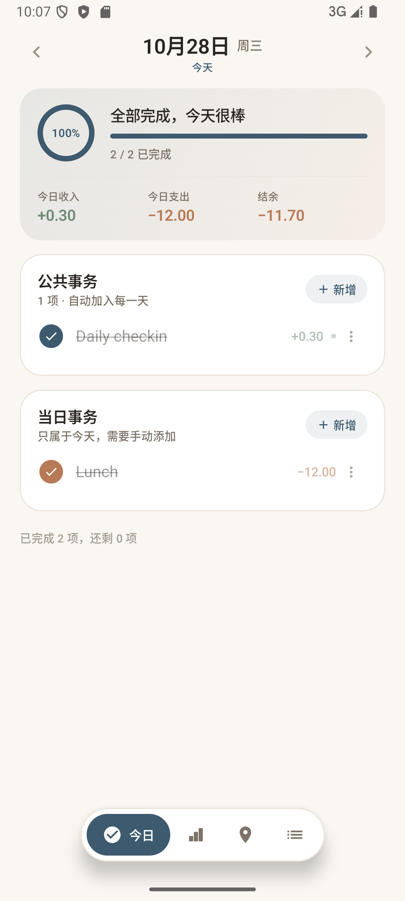
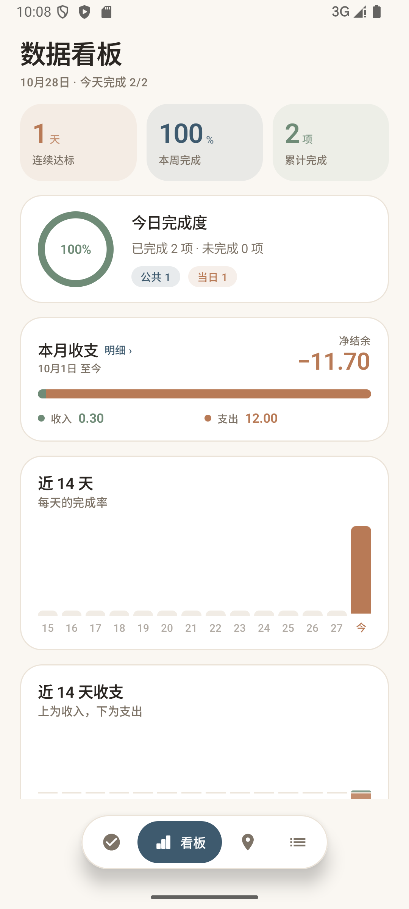
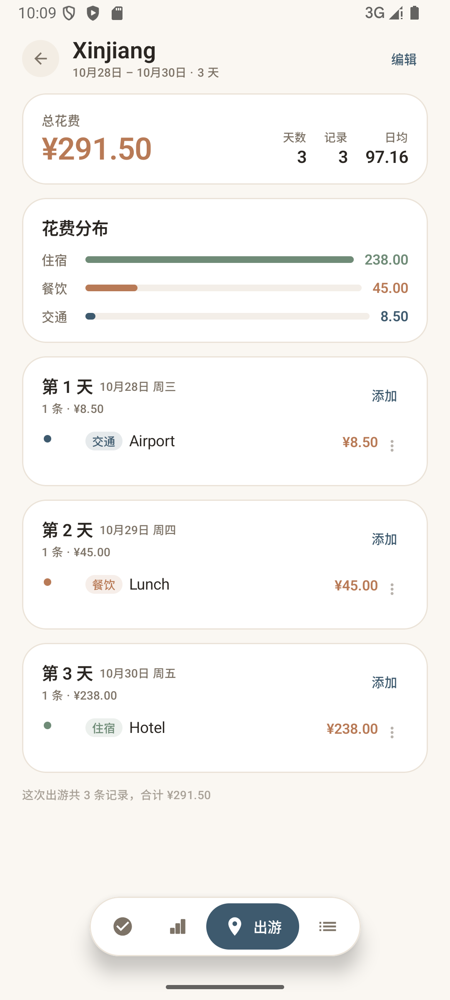
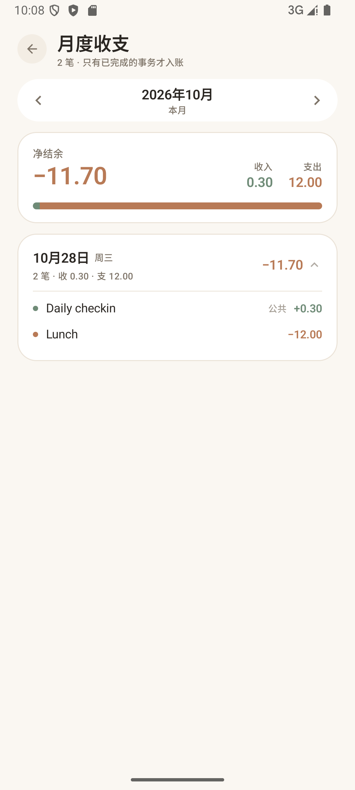
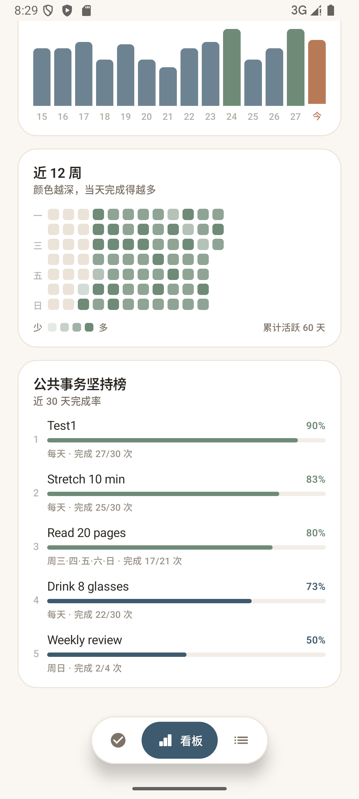
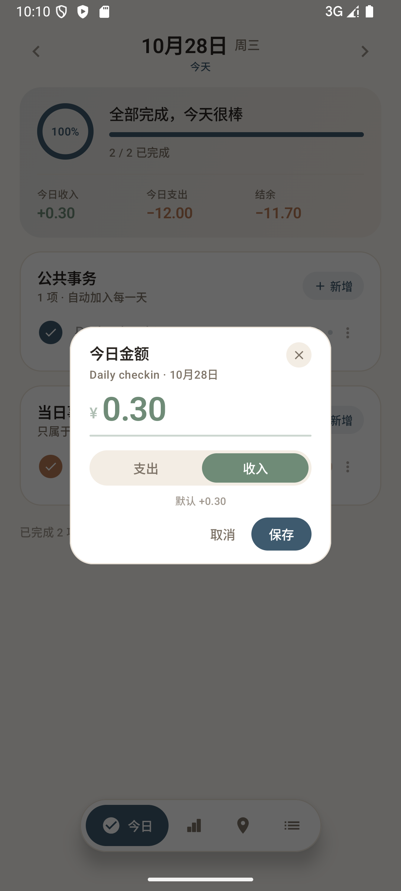

# 日常 Daylog

一个纯本地的 Android 日记 / 每日待办应用。没有账号、没有服务端、没有埋点，也不申请网络权限。

数据存储方式参考了 [LumiDesk/verifin](https://github.com/LumiDesk/verifin) 的做法：
本地 SQLite 存业务数据，备份用 PBKDF2 派生密钥 + AES-GCM 整体加密后落盘。

## 界面

| 今日 | 看板 | 出游 |
| --- | --- | --- |
|  |  |  |

| 月度收支明细 | 坚持榜 | 修改今日金额 |
| --- | --- | --- |
|  |  |  |

## 功能

**今日**
- 公共事务：按星期规则每天自动出现在清单里（默认每天，也可只选周一/工作日等）
- 当日事务：手动新增，只属于那一天，支持编辑、顺延到明天、删除
- 勾选即完成，圆环 + 进度条实时反映当天完成度
- 左右箭头切换日期，可回看和补记历史
- **金额**：每条事务可挂一笔收入或支出，今日卡片底部汇总「收入 / 支出 / 结余」
- **公共事务按天改金额**：公共事务在今日清单里可以单独改当天的金额和方向（比如默认 +0.30，
  今天实际到账 +0.68），入口是行尾「更多」→「修改今日金额」；弹窗里点「恢复默认」可退回
  事务本身的默认金额。只影响那一天，不动默认值，也不影响其他日期

**看板**
- 连续达标天数、本周完成率、累计完成数
- 今日完成度环
- 本月收支（净结余 + 收支对比条）、近 14 天收支双向柱状图
- **月度收支明细**：点「本月收支」进入，按月列出每天的收入 / 支出，点开某天能看到每一笔
  来自哪条事务（标明公共 / 当日、收入 / 支出）；顶部可切换月份
- 近 14 天每日完成率柱状图
- 近 12 周热力图
- 公共事务近 30 天坚持榜

**出游**（独立模块，见下）
- 记录一次旅行的行程：按天分组，每条含类型、时间、标题、说明、花费
- 自动汇总总花费、日均、按类别（交通 / 餐饮 / 住宿 / 购物 / 景点 / 其他）的分布
- **与每日事务完全独立**：不生成待办、不进看板、不计入任何收支报表

**事务**
- 公共事务增删改、归档（归档后不再出现在清单，历史打卡保留）
- **删除只影响今天以后**：删除时给事务记一个「截止日 = 昨天」，今天及以后的清单里不再出现，
  27 日、28 日等更早的日期照旧能看到它、勾选状态和当天金额都保留，收支汇总也不受影响
- 导出加密备份 / 从备份恢复（可覆盖或合并）

## 存储设计

五张表，公共事务只存规则、不预生成每日记录，避免"后来改了规则，历史跟着变"：

| 表 | 作用 |
| --- | --- |
| `routine` | 公共事务定义：标题、备注、`weekdays` 位掩码、排序、归档、创建时间、默认金额、`endDate` 截止日、`deleted` 标记 |
| `day_task` | 当日事务：绑定 `yyyy-MM-dd`，含完成状态、完成时间、金额 |
| `routine_check` | 公共事务在某天的完成状态 + 当天实际入账金额，主键 `(routineId, date)` |
| `trip` | 出游：标题、目的地、起止日期、备注 |
| `trip_item` | 行程条目：所属出游、日期、时间、类别、标题、说明、花费 |

某一天的清单由三者实时合成（`Stats.dayState`），所以：

- 新建的公共事务不会给"它出生之前"的日子记未完成
- 删除当日事务不影响公共事务，反之亦然
- 统计口径集中在 `Stats` 里，是纯函数，方便单测

`weekdays` 用位掩码：bit0=周一 … bit6=周日，`127` 即每天。

### 金额怎么存

- 一律以**分**为单位存 `Long`，解析和格式化都走字符串（`Money`），全程不碰 `Double`
- `amountKind`：`0` 无 / `1` 收入 / `2` 支出，通过 `Converters` 在枚举和 Int 之间转换
- 公共事务打卡时把当时金额写进 `routine_check.amount` 固定下来，之后改默认金额不影响历史
- 按天改金额复用同一组字段：`routine_check.amount = 0` / `amountKind = NONE` 表示"沿用默认"，
  非 0 即当天的覆盖值（方向同理）。用哨兵值而不是新增可空列，`routine_check` 只有一行记录，
  不用区分"未打卡但改了金额"和"已打卡"
- **只有已完成的事务才计入任何收支汇总**，未完成的金额只是"预期"

### 删除为什么不是物理删除

公共事务只存规则，历史某天的清单是"规则 + 打卡记录"实时算出来的。如果直接把规则行删掉，
27 日、28 日的清单也会跟着少一条，等于把过去一起抹掉。

所以删除只是给 `routine` 打上 `endDate = 昨天` 和 `deleted = 1`：

- `activeOn(day)` 只看"星期命中 且 day ≤ endDate"，于是今天往后不再出现，之前的日子照旧
- 今天及以后的 `routine_check` 一并清掉（那部分本来就要删），更早的打卡和金额原样保留
- `deleted` 只用于把这条记录从「事务」页藏起来，不参与 `activeOn`，历史才能继续回溯

归档走的是同一套：`archived = 1` + `endDate = 昨天`，取消归档把 `endDate` 清空即可复原。
今天刚建、没有任何历史打卡的事务没什么可留的，删除时直接物理删除。

### 数据库版本

- v1 → v2：增加上述金额列（`MIGRATION_1_2`）
- v2 → v3：新增出游的 `trip` / `trip_item` 两张表（`MIGRATION_2_3`），不动原有表
- v3 → v4：`routine` 增加 `endDate` / `deleted`（`MIGRATION_3_4`），并给升级前已归档的事务
  补上截止日，避免它们升级后又在清单里复活

迁移脚本在 `AppDatabase` 里，用 `MigrationTestHelper` 配合 `app/schemas` 导出的历史 schema
做回归测试（`MigrationTest`）：建旧版本的库 → 写入旧数据 → 跑迁移 → 校验 schema 一致且数据没丢。

### 出游为什么单独两张表

出游和每日事务是两条互不相干的数据线：一个问"今天该做什么"，一个问"这趟旅行花了多少"。
所以 `trip_item` 不引用 `routine` / `day_task`，也不参与 `Stats` 的任何口径
（完成率、连续达标、收支汇总都不看它）。`TripStats` 是独立的一套纯函数。

行程按 `trip.startDate + dayCount` 铺满整个区间，没记录的天也留一行，方便按天补记；
同一天内按时间排序，没填时间的排最后。缩短行程后落在区间外的条目会被忽略但不会被删除。

## 备份格式

文件由 `MAGIC(6) | version(1) | encrypted(1) | salt(16) | iv(12) | ciphertext` 组成。

- 密码为空 → 存明文 JSON，方便直接查看
- 有密码 → `PBKDF2WithHmacSHA256` 迭代 120000 次派生 256 位密钥，`AES/GCM/NoPadding` 加密，每次导出随机 salt 与 iv
- v3 起 JSON 里多了 `trips` / `tripItems` 两组；读旧备份时缺省为空，旧版 App 读新备份会忽略这两组

导入时如果选"合并"，会给公共事务和出游重新分配 id 并重映射关联记录，不会与现有数据撞主键。

## 构建

```bash
./gradlew :app:assembleDebug      # 调试包
./gradlew :app:assembleRelease    # 发布包（当前用 debug 签名，正式发布请换成自己的 keystore）
./gradlew :app:testDebugUnitTest  # 备份加解密 / 金额解析 / 统计口径单测
```

环境：JDK 17、Android SDK 34、Gradle 8.9。`minSdk 26`（用到 `java.time`）。

## 技术栈

Kotlin · Jetpack Compose（Material 3）· Room · DataStore · Coroutines/Flow

图表（柱状图、热力图、进度环）全部用 Compose 布局和 Canvas 自绘，没有引入图表库。

## 目录

```
app/src/main/java/com/dailybook/app/
├── DaylogApp.kt
├── MainActivity.kt          # 导航与底部胶囊栏（今日 / 看板 / 出游 / 事务）
├── data/
│   ├── Models.kt            # 实体与视图模型
│   ├── DiaryDao.kt
│   ├── TripDao.kt           # 出游的数据访问
│   ├── AppDatabase.kt
│   ├── DiaryRepository.kt
│   ├── TripRepository.kt
│   ├── Stats.kt             # 每日事务的所有统计口径（纯函数）
│   ├── TripStats.kt         # 出游的统计口径，与 Stats 互不引用
│   ├── Money.kt             # 金额解析与格式化（分为单位）
│   ├── Converters.kt        # AmountKind / TripKind <-> Int
│   ├── Backup.kt            # 加密备份编解码
│   └── Dates.kt
└── ui/
    ├── DiaryViewModel.kt
    ├── theme/Theme.kt       # 配色、字体、图表语义色
    ├── components/          # 卡片、任务行、进度环、图表、各类弹窗
    └── screens/             # 今日 / 看板 / 月度明细 / 出游列表 / 出游详情 / 事务
```

## 已知边界

- 公共事务的重复规则只支持"按星期"，没有"每 N 天""每月某日"
- 金额上限 ¥999,999,999.99（分存 `Long`，输入侧限 9 位整数 + 2 位小数）
- 按天改金额只能改金额和方向，不能改标题/备注（那是公共事务本身的属性）
- 出游条目只记花费（不区分收入/支出），也**不进任何报表**——这是刻意的隔离
- 出游的起止日期用「出发日 + 天数」两步调整，没有日历选择器
- 删除公共事务没有"撤销"，删错了需要重新建一条（历史记录仍在，不会丢）
- 不提醒、不推送（没有通知权限）
- 没有桌面小组件
- 合并导入同一份备份两次会产生重复的公共事务（符合"合并"语义）

## 安装包
- Daylog-1.3.1.apk
